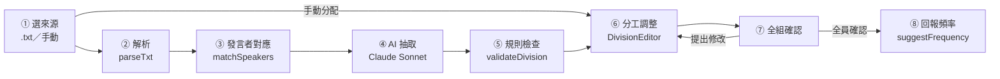
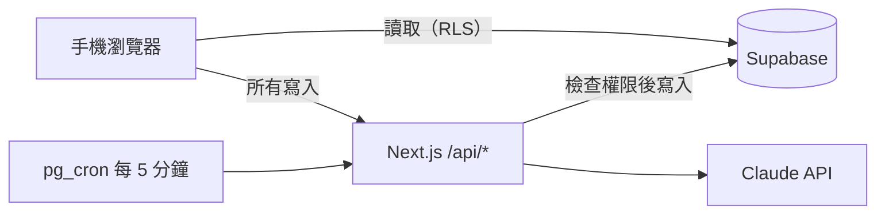

# 第 4 組專題協作 App（g4-app）

多媒體課程第 4 組的期末專題。這是一個**手機優先**的 web app，幫小組把「誰做什麼」說清楚、進度公開透明，有人卡住或失聯時有一套不靠情緒的處理流程。

- **分工**：上傳討論逐字稿 → AI 整理分工草稿 → 規則檢查 → 全組確認
- **回報**：每個任務各自的回報頻率、七階段進度、匿名隨機檢查
- **求助與協調**：主動求助、失聯時的需要協調事件（橘色倒數 → Agent 介入 → 通知助教）
- **期末**：貢獻摘要、自評與組員評語、交給助教

> 📌 **第一次來？** 依序讀：本頁 → [`docs/setup.md`](docs/setup.md)（裝環境）→ [`CONTRIBUTING.md`](CONTRIBUTING.md)（開發流程）→ [`docs/roles.md`](docs/roles.md)（你的角色從哪裡開始）。
> 用 AI agent 寫程式的人，讓 agent 先讀 [`AGENTS.md`](AGENTS.md)。

---

## 目前狀態

| 里程碑 | 日期 | 內容 | 狀態 |
| --- | --- | --- | --- |
| Repo 初始化 | 11/27 | 專案骨架、共用型別、資料表、文件 | ✅ |
| **Core demo** | **12/1（二）** | 上傳逐字稿 → 分工生效 | 🚧 Week 1 |
| 情境一到三 | 12/13 | 回報、檢查、求助、協調在真實系統跑完 | ⬜ Week 2 |
| 期末全流程 | 12/20 | 期末摘要、助教頁、使用者測試、demo 影片 | ⬜ Week 3 |

目前所有頁面都是 placeholder、API 都回 `501 NOT_IMPLEMENTED`，每個檔案都標了負責人與 `TODO`。

## Week 1 Core 流程



只有 ④ 用 LLM，其他都是可以單元測試的規則。LLM **只能指派討論中明確說好的負責人**，沒有結論就留空，交給組員補上——所以「有人在討論中沉默 → 沒分到工作 → 橘色警告」會自然出現。

## 快速開始

需要 **Node 24**（最低 22.12）與 **pnpm 10**。詳細步驟與常見問題見 [`docs/setup.md`](docs/setup.md)。

```bash
git clone <repo 網址> && cd g4-app
pnpm install
cp .env.example .env.local    # 填入 C 私下提供的金鑰
pnpm dev                      # http://localhost:3000
```

沒有金鑰也能開發畫面：頁面照常顯示，資料用 `mocks/`。

## 指令

| 指令 | 用途 |
| --- | --- |
| `pnpm dev` | 開發伺服器 |
| `pnpm check` | lint＋型別檢查＋單元測試（**push 前 hook 會自動跑**，CI 也跑這些） |
| `pnpm test` / `pnpm test:watch` | 單元測試（Vitest） |
| `pnpm build` | production build（CI 會跑） |
| `pnpm format` | Prettier 排版 |
| `pnpm eval` | LLM 抽取品質評估（花 API 費用） |
| `pnpm db:types` | 從 Supabase 產生 `lib/supabase/types.ts` |
| `pnpm test:e2e` | Playwright 情境測試（Week 3） |

## 技術選型

| 層級 | 選用 |
| --- | --- |
| 前端 | Next.js 16（App Router）、React 19、TypeScript、Tailwind CSS v4、PWA |
| 表單與驗證 | React Hook Form、zod v4（前端表單、API 輸入、LLM 輸出共用同一份 schema） |
| 後端 | Next.js Route Handlers（所有寫入都經過這裡） |
| 資料庫與登入 | Supabase：Postgres＋RLS、Auth（Google）、Realtime、pg_cron、pgvector |
| LLM | Claude API：`claude-sonnet-5-5`（抽取、方案、摘要）、`claude-haiku-5-5`（改寫），structured outputs 強制 JSON |
| 部署 | Vercel（`main` → 測試站預覽網址；`release` → 正式網址，由 C 更新） |
| 測試 | Vitest（parser、規則）、Playwright（情境）、`eval/`（LLM 品質） |



## 專案結構

```
g4-app/
├─ app/                      頁面與 API（Next.js App Router）
│  ├─ p/[pid]/division/      ★ Week 1 Core 五個頁面（A）
│  ├─ login/ join/ p/new/    登入、加入、建專題（B）
│  └─ api/                   Route Handlers（C、D）
├─ components/
│  ├─ ui/                    共用元件（B）
│  └─ division/              DivisionEditor 等（A）
├─ lib/
│  ├─ schemas/               ★ 共用 zod 型別：前後端與 LLM 的契約
│  ├─ api/                   API 共用：handle()、錯誤格式、requireMember()
│  ├─ supabase/              Supabase client（瀏覽器／伺服器／admin）
│  ├─ transcript/            .txt parser、發言者配對（D）
│  ├─ rules/                 規則檢查、回報頻率（D）
│  ├─ agent/                 LLM 封裝、prompt、輸出轉換（E）
│  └─ time.ts env.ts         Asia/Taipei 日期工具、環境變數
├─ mocks/                    前端開發用假資料（測試保證符合 schema）
├─ supabase/migrations/      資料表與 RLS（C）
├─ eval/                     測試逐字稿、人工標註、評估腳本（E）
├─ tests/unit/               Vitest 單元測試
├─ public/samples/           上傳頁的範例逐字稿
└─ docs/                     規格與說明文件
```

## 文件

| 文件 | 內容 |
| --- | --- |
| [`docs/implementation-plan.md`](docs/implementation-plan.md) | **完整規格**：功能、資料表、API、Agent 設計、時程、風險 |
| [`docs/spec-changes.md`](docs/spec-changes.md) | 對原規格的修正紀錄（改規格前必讀） |
| [`docs/roles.md`](docs/roles.md) | 五個角色各自從哪裡開始、依賴誰、12/1 前要完成什麼 |
| [`docs/setup.md`](docs/setup.md) | 本機環境；Supabase、Google 登入、Vercel、Claude API 設定 |
| [`docs/conventions.md`](docs/conventions.md) | 命名、API 寫法、錯誤碼、日期時間、UI token、測試 |
| [`CONTRIBUTING.md`](CONTRIBUTING.md) | **開發流程**：直接 commit 到 main 的規則、避免衝突、解衝突、AI agent 規則 |
| [`AGENTS.md`](AGENTS.md) | 給 AI coding agent 的守則（`CLAUDE.md` 引用它） |
| [`eval/README.md`](eval/README.md) | LLM 評估：逐字稿清單、標註格式、指標 |
| [`mocks/README.md`](mocks/README.md) | 假資料說明 |

## 分工

| 角色 | 負責 | 組員 |
| --- | --- | --- |
| A｜前端（分工與回報） | division 五頁、DivisionEditor、回報頁、期末頁 | |
| B｜前端（框架、事件、聊天） | 元件庫、登入、建專題、邀請、首頁、事件頁、聊天室、助教頁 | |
| C｜後端（資料與 API） | Supabase、資料表與 RLS、主要 API、部署 | |
| D｜後端（逐字稿與規則） | parser、規則、排程、通知、情境測試 | |
| E｜Agent／AI | prompt、LLM 封裝、eval、RAG、期末摘要 | |

## 規則摘要

- **直接 commit 到 `main`，不用 PR**：開工前與 push 前都 `git pull`（rebase）；push 時 hook 自動跑 `pnpm check`，沒過推不上去；至少每半天 push 一次（[`CONTRIBUTING.md`](CONTRIBUTING.md)）
- **只改自己的資料夾**；`lib/schemas/`、migration、`package.json` 等共用檔案，改之前先在群組講，改完單獨 commit 並馬上 push
- **做好別人在等的東西 → push → 群組通知**，這就是交接（順序見 [`docs/roles.md`](docs/roles.md)）
- **`main` 壞了弄壞的人立刻修或 `git revert`**；正式網址只部署 `release`，由 C 更新
- **不要 commit 金鑰**：`.env.local` 已被 `.gitignore` 擋掉，金鑰只透過群組私下傳
- **真實逐字稿要先取得全組同意**才能放進 `eval/transcripts/`
- **11/30 21:00 凍結**，之後只合併 demo 必要的修正
