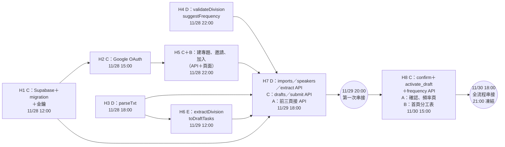

# 各角色入門

每個角色：**負責什麼 → 第一天從哪個檔案開始 → 依賴誰、等不到怎麼辦 → 12/1 demo 前要完成什麼**。
完整時程見 `implementation-plan.md`「三週時程與五人分工」。找自己的工作：`grep -rn "TODO(A)" app components lib`（把 A 換成你的角色）。

| 角色 | 組員 | GitHub |
| --- | --- | --- |
| A｜前端（分工與回報） | | |
| B｜前端（框架、事件、聊天） | | |
| C｜後端（資料與 API） | | |
| D｜後端（逐字稿與規則） | | |
| E｜Agent／AI | | |

## Week 1 先後順序

### 誰一定要先動工

| 順序 | 誰 | 什麼時候開始 | 為什麼 |
| --- | --- | --- | --- |
| 0 | **repo 建立者** | 11/27 晚上 | push 到 GitHub、邀請組員，大家才能 clone |
| 1 | **C** | **11/28 一早，第一件事** | Supabase、金鑰、migration 沒好，**所有碰到資料庫的東西都不能真的跑**：D 的 imports API、C 自己的 API、B 的登入、E 呼叫 Claude 都要等 |
| 1 | **D** | **11/28 一早**（跟 C 同時） | `parseTxt()` 被三個人等：E 的 eval（11/29 上午）、D 自己的 imports API、extract 流程；`validateDivision()` 被 A、C 等。好消息是它們是純函式，**不依賴任何人**，可以馬上開始 |
| 2 | **E** | 11/28（不依賴別人） | 逐字稿＋人工標註、prompt 不用等任何人；但 `extractDivision()` 要在 11/29 中午前給 D 串 extract API |
| 3 | **B** | 11/28 | 先做 A 會用到的基本元件（按鈕、卡片、頭貼），A 才不用自己刻；登入要等 C 設好 Google OAuth |
| 3 | **A** | 11/28 | 完全可以先用 `mocks/` 開發，不會被卡住；從最複雜的分工調整頁開始 |

**關鍵路徑**（最容易延誤 demo 的一條線）：
C 建好 Supabase → D 的 imports／speakers API → E 的 `extractDivision()` → D 的 extract API → A 的頁面串上 API → **11/29 晚上第一次串接**。
這條線上任何一個交付點晚了，後面全部跟著晚。

### 交付點

每個交付點：**做好 → `git push` → 在群組說「H3 好了，可以 pull」**。來不及的話**提早**在群組說，不要等到期限才說。

| # | 期限 | 誰 | 交付什麼 | 誰在等 | 等不到時的替代方案 |
| --- | --- | --- | --- | --- | --- |
| H0 | 11/27 晚上 | repo 建立者 | GitHub repo、邀請組員 | 全員 | — |
| H1 | **11/28 12:00** | C | Supabase 專案、migration 套用、`types.ts` commit、`.env.local` 的值私下傳給大家、Claude API key 給 E | D、C、B、E | D、E 先做純函式與 prompt；A、B 用 mock |
| H2 | 11/28 15:00 | C | Supabase 開好 Google 登入與 redirect URL | B | B 先做登入畫面，按鈕先不接 |
| H3 | **11/28 18:00** | D | `parseTxt()`＋測試通過 | E（eval）、D（imports API） | E 先在 `eval/` 寫一個暫時的簡易 parser |
| H4 | 11/28 22:00 | D | `validateDivision()`、`suggestFrequency()`＋測試 | A（即時警告）、C（PATCH／submit） | A 用 mock 裡的 `warnings`；C 先回 `[]` |
| H5 | **11/28 22:00** | C（API）＋B（頁面） | 登入 → 建專題 → 邀請連結 → 加入，可以真的走完 | **所有 API**（`requireMember()` 需要真的組員資料） | C 在 Supabase Studio 手動建一個測試專題與 5 個組員 |
| H6 | **11/29 12:00** | E | `extractDivision()`、`toDraftTasks()`＋測試；至少一份逐字稿的回應存進 `eval/cache-demo/` | D（extract API） | D 的 extract API 先回 `mocks/division-draft.json` |
| H7 | **11/29 18:00** | D、C、A | D：imports、speakers、extract API；C：建立草稿、PATCH、submit API；A：選來源、發言者對應、分工調整三頁接上 API | 11/29 20:00 第一次串接 | — |
| H8 | 11/30 15:00 | C、A、B | C：confirm＋`activate_draft()`＋frequency API；A：確認頁、頻率頁；B：首頁分工表 | 11/30 18:00 全流程串接 | 首頁分工表來不及就 demo 時停在頻率設定頁 |
| — | 11/30 21:00 | C | `main` 推到 `release`，全組在正式網址彩排 | demo | — |

### 工作量提醒

**C 在 11/28 的工作最多**（H1、H2、H5 都在同一天）。如果 11/28 下午看起來會來不及：

- 邀請／加入 API（`api/projects/[pid]/invites`、`api/join/[code]`）交給 B 做，B 本來就在做這兩頁
- C 先在 Studio 手動建測試資料（H5 的替代方案），讓其他人可以先串接

**原則：除了關鍵路徑，沒人需要乾等**。前端用 `mocks/`，API 先回 stub（目前都是 501），parser 與規則是純函式可以單獨測，LLM 可以先用 `LLM_USE_CACHE=1`。

---

## A｜前端（分工與回報）

**負責**：`app/p/[pid]/division/` 五頁、`components/division/`（`DivisionEditor`、`AssigneePicker`、`CoverageBar`）、警告橫幅。

**第一天從這裡開始**

1. `mocks/division-draft.json`、`mocks/members.json` — 你的假資料，已經包含三則警告
2. `components/division/DivisionEditor.tsx` — props 已定義
3. `lib/schemas/division.ts`、`lib/schemas/api.ts` — 你要送給 API 的格式
4. `app/p/[pid]/division/edit/page.tsx` — 先把 mock 塞進 `DivisionEditor` 顯示出來

**依賴**

- 警告：`validateDivision()`（D）。D 完成前先直接用 mock 裡的 `warnings`。
- API（C、D）：完成前全部用 mock；串接時只要把讀 mock 的地方換成 `fetch`。

**12/1 前完成**

- [ ] 選來源頁（上傳 .txt、手動分配入口、格式說明與範例檔下載連結 `/samples/transcript-example.txt`）。說明文字要寫「可以直接上傳 LINE 聊天記錄匯出檔」（見 `docs/spec-changes.md` #21）
- [ ] 發言者對應頁（含補討論日期）
- [ ] 分工調整：警告、未指派選人（沒工作的人標出）、改截止日、新增任務、多人負責
- [ ] 全組確認頁：確認／提出修改、重新整理後看到人數
- [ ] 回報頻率頁：建議值＋三個預設選項

## B｜前端（框架、事件、聊天）

**負責**：元件庫與設計 token、登入、建專題、邀請、首頁分工表、PWA 殼。

**第一天從這裡開始**

1. `app/globals.css` — 依 prototype 調整色碼（token 名稱不要改，大家都在用）
2. `components/ui/` — 按鈕、卡片、頭貼、進度色塊，**先做 A 需要的**（按鈕、卡片、頭貼）
3. `app/login/page.tsx` ＋ `app/auth/callback/route.ts`（已寫好）＋ `lib/supabase/proxy.ts` 的 TODO（未登入導向）
4. `app/p/new/page.tsx`、`app/p/[pid]/invite/page.tsx`、`app/join/[code]/page.tsx`

**依賴**

- Google 登入要等 C 設定好 Supabase Auth（見 `setup.md` 2-2）。等待時先做畫面與元件。
- 建專題、加入的 API（C）。

**12/1 前完成**

- [ ] Google 登入、登出
- [ ] 建專題表單（React Hook Form＋`CreateProjectInput`）
- [ ] 邀請連結頁、加入頁
- [ ] 首頁：生效後的分工表
- [ ] A 用得到的基本元件

## C｜後端（資料與 API）

**負責**：Supabase、Vercel、GitHub 設定；資料表與 RLS；projects、invites、join、drafts、submit、confirm、frequency API；`activate_draft()`。

**第一天從這裡開始**

1. `docs/setup.md` 第 2 部分 — 建 Supabase、Google OAuth、Vercel、Claude key，**11/28 上午完成**並把 `.env.local` 的值私下傳給大家
2. `supabase/migrations/20261128000000_week1_core.sql` — 檢查後 `pnpm supabase db push`，再 `pnpm db:types` 並 commit
3. `lib/api/http.ts`、`lib/api/auth.ts` — 已寫好的共用工具，先讀懂
4. `app/api/projects/route.ts` — 每個 stub 都列了步驟，照順序實作

**依賴**

- `validateDivision()`（D）：PATCH／submit 會用到。D 完成前先回 `[]`。

**12/1 前完成**

- [ ] migration 套用、型別產生、Realtime 開啟
- [ ] `POST /api/projects`、`/invites`、`/join/[code]`
- [ ] `POST /projects/[pid]/drafts`、`PATCH /drafts/[did]`、`/submit`、`/confirm`
- [ ] `activate_draft()`（新的 migration 檔）
- [ ] `PUT /tasks/[tid]/frequency`
- [ ] Vercel 部署：Production branch 設成 `release`（`CONTRIBUTING.md` 第 8 節、`setup.md` 2-3）
- [ ] 11/30 21:00 把 `main` 推到 `release`，demo 前清掉測試資料

## D｜後端（逐字稿與規則）

**負責**：.txt parser（LINE 匯出、標準格式）、發言者配對、`validateDivision`、`suggestFrequency`、imports／speakers／extract API、單元測試。

**第一天從這裡開始**

1. `tests/unit/parse-txt.test.ts` — regex 的測試已經會通過；把 `parseTxt` 的 `it.todo` 改成真的測試
2. `lib/transcript/parse-txt.ts` — 實作 `parseTxt()`，規則寫在註解
3. `tests/unit/validate-division.test.ts` ＋ `lib/rules/validate-division.ts`
4. `lib/transcript/match-speakers.ts`、`lib/rules/suggest-frequency.ts`

**依賴**

- imports／speakers API 要等 C 的 migration；純函式不用等任何人。
- extract API 要等 E 的 `extractDivision()`；E 完成前可以先回傳 `mocks/division-draft.json`。

**12/1 前完成**

- [ ] `parseTxt`、`matchSpeakers`、`validateDivision`、`suggestFrequency` ＋ 測試全部通過
- [ ] `POST /projects/[pid]/imports`、`PUT /imports/[iid]/speakers`、`POST /imports/[iid]/extract`

## E｜Agent／AI

**負責**：抽取 prompt、LLM 封裝、`toDraftTasks`、切塊（12/2 後）、測試逐字稿與人工標註、`run-eval.ts`、demo 回應快取。

**第一天從這裡開始**

1. `eval/README.md` — 要準備的 5 份逐字稿；`script-silent-member.txt` 與標註已完成，可當範本
2. `lib/agent/prompts/extract-division.ts` — 第一版 prompt 已依硬規則寫好
3. `lib/agent/llm.ts` — `generateStructured()` 已寫好（structured outputs＋fallback）
4. `lib/agent/to-draft-tasks.ts`、`lib/agent/extract-division.ts`、`eval/run-eval.ts`

**依賴**

- `parseTxt()`（D）：eval 要先解析逐字稿。D 完成前可以自己寫一個最簡單的版本放在 `eval/` 裡暫用，不要放進 `lib/`。

**12/1 前完成**

- [ ] 至少 3 份逐字稿＋人工標註，跑過 `pnpm eval`，**亂填負責人次數 = 0**
- [ ] `extractDivision()`、`toDraftTasks()` ＋ 測試
- [ ] 3 份 demo 逐字稿的 LLM 回應存進 `eval/cache-demo/`，`LLM_USE_CACHE=1` 可以走完全程
- [ ] 真實逐字稿取得全組同意（在群組留下紀錄）
